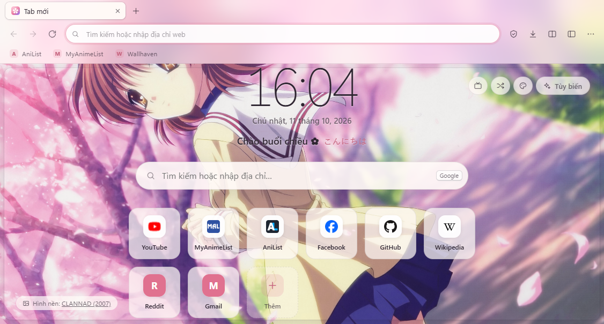
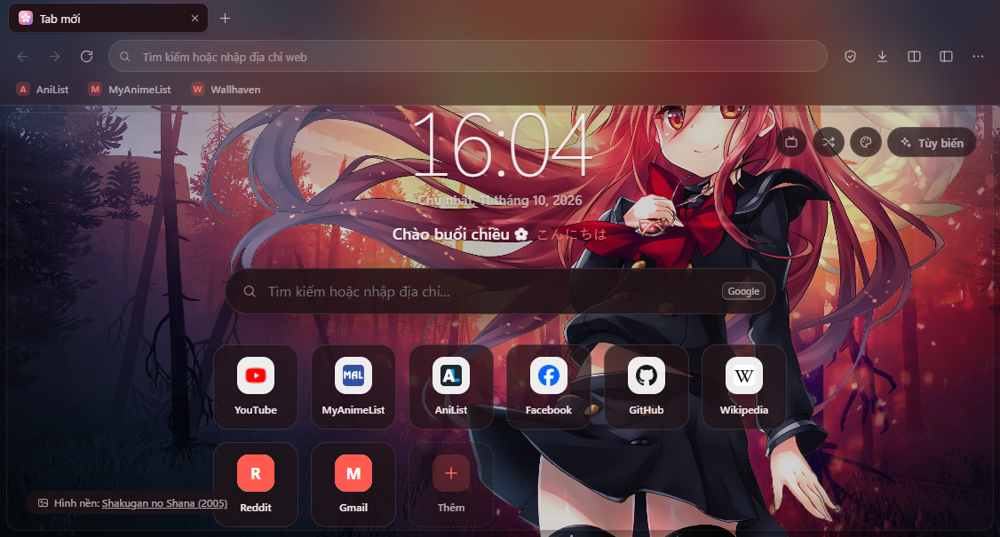
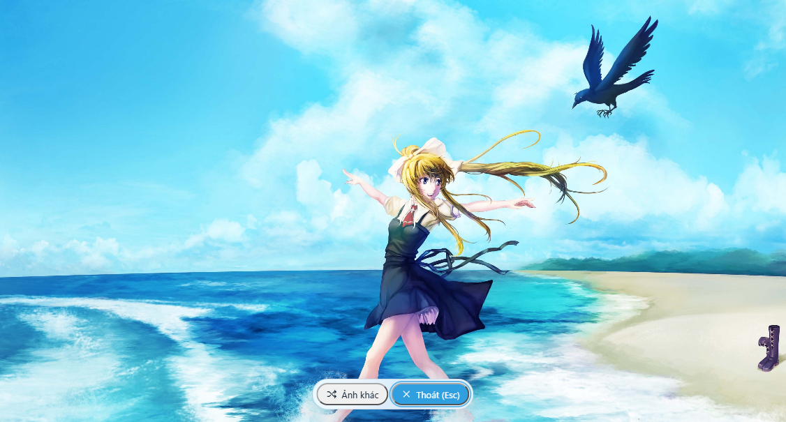
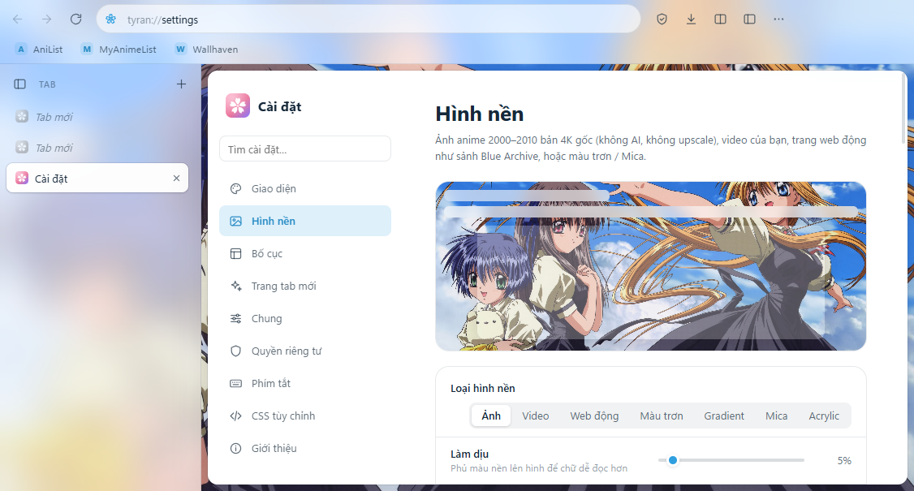
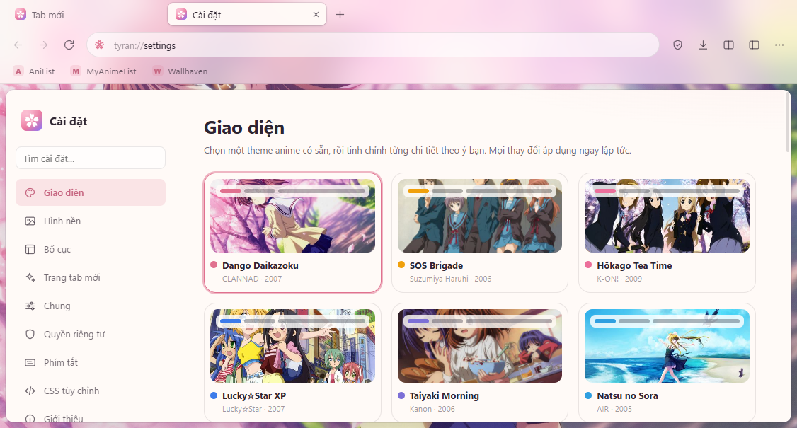
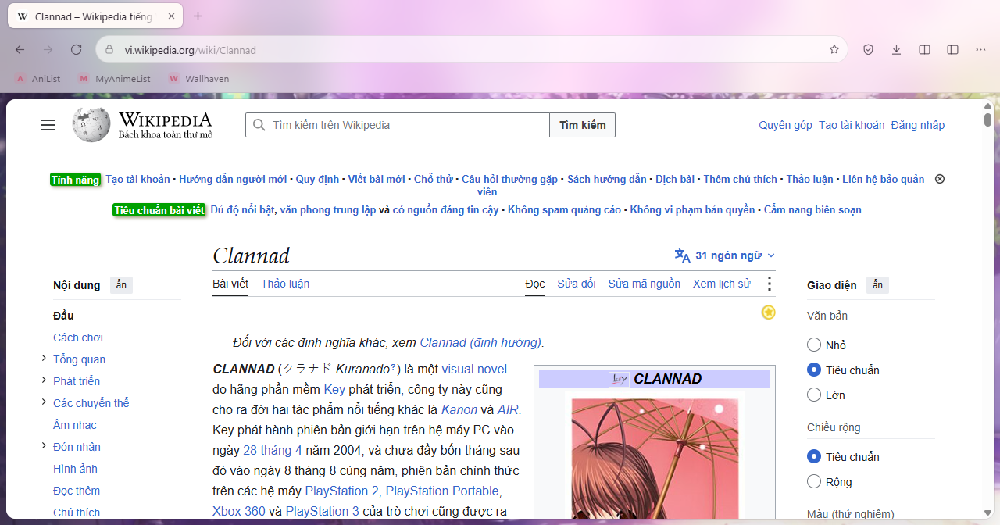

# TyranWeb ✿

Trình duyệt web chủ đề **anime 2000–2010**, giao diện tối giản và **tùy biến được gần như mọi thứ**.
Xây trên Electron (Chromium), nên các trang web hiển thị giống Chrome/Edge.


| | |
|---|---|
|  |  |
|  |  |
|  |  |

## Chạy thử

Cần Node.js 20+ (đã thử với Node 26, Electron 44.4.5).

```bash
npm install
npm start
```

Đóng gói thành bộ cài `.exe` cho Windows (tạo trong thư mục `dist/`):

```bash
npm run dist
```

Bản chạy ngay không cần cài: `dist/win-unpacked/TyranWeb.exe` (tạo bằng `npx electron-builder --win dir`).
Nếu `npm run dist` đứng yên sau dòng `downloaded … nsis`, xóa thư mục `%LOCALAPPDATA%\electron-builder\Cache` rồi chạy lại.

Tạo lại icon từ `src/shared/logo.svg`: `npm run icon`. Tối ưu lại ảnh nền: `npm run wallpapers` (cần đặt ảnh gốc vào `assets/wallpapers/_raw/`, danh sách ảnh và link tải nằm trong `_picks.json`; ảnh được thu về rộng tối đa 3840px).

Hồ sơ riêng (portable / thử nghiệm) — dữ liệu được lưu vào thư mục bạn chọn (PowerShell):

```powershell
$env:TYRAN_PROFILE = "D:\TyranProfile"; npm start
```

## Tính năng trình duyệt

- Tab: kéo thả để sắp xếp, ghim, tắt tiếng, nhân đôi, mở lại tab vừa đóng, tab ngủ để tiết kiệm RAM, khôi phục phiên làm việc cũ, cửa sổ ẩn danh.
- Thanh địa chỉ thông minh: gợi ý từ tab đang mở, dấu trang, lịch sử và công cụ tìm kiếm, kèm tự hoàn thành tên miền. Hỗ trợ Google, Bing, DuckDuckGo, Brave, Cốc Cốc hoặc URL tự đặt.
- Dấu trang: thanh dấu trang, thư mục, trang quản lý, nhập/xuất HTML (đọc được file xuất từ Chrome/Edge/Firefox).
- Lịch sử có tìm kiếm và xóa theo khoảng thời gian.
- Tải xuống: tạm dừng/tiếp tục/hủy và theo dõi tiến trình.
- Tìm trong trang, thu phóng (nhớ riêng cho từng trang), in, lưu trang, lưu PDF, xem mã nguồn, DevTools, toàn màn hình.
- Chặn quảng cáo và trình theo dõi bằng bộ lọc Ghostery, đếm số mục bị chặn trên từng trang.
- Gửi tín hiệu Do Not Track / GPC, tùy chọn xóa dữ liệu khi thoát.
- Hỏi quyền camera, micro, thông báo… và ghi nhớ quyết định cho từng trang.
- Kiểm tra chính tả tiếng Anh và tiếng Việt.

## Tiện ích thêm

| Tính năng | Cách dùng |
|---|---|
| Bảng lệnh (tìm lệnh, tab, theme, dấu trang, lịch sử; gõ không dấu cũng được) | `Ctrl+K` hoặc `Ctrl+Shift+A` |
| Chia đôi màn hình 2 tab, kéo để đổi tỉ lệ | `Ctrl+Shift+X`, hoặc chuột phải vào tab |
| Thanh bên: dấu trang, lịch sử, tải xuống, ghi chú nhanh, web panel (trang web thu nhỏ, ví dụ MyAnimeList) | `Ctrl+Shift+E` |
| Chụp màn hình trang (lưu vào Pictures\TyranWeb và chép vào clipboard) | `Ctrl+Shift+S` |
| Hình trong hình cho video | `Alt+P` |
| Chế độ tập trung: ẩn toàn bộ giao diện, đưa chuột lên mép trên để hiện lại | `Ctrl+Shift+Z` |
| **Chế độ Lobby**: ẩn trình duyệt để ngắm hình nền, hoặc chơi với nền động. Với Blue Archive: giữ chuột kéo trên đầu để xoa đầu, kéo ở má để véo má (học sinh có tương tác này), kéo chỗ khác để học sinh nhìn theo, bấm nhẹ để trò chuyện — vùng chạm lấy từ rig riêng của từng học sinh, như trong game | `Ctrl+Shift+L`, thoát bằng `Esc` |
| Đổi theme / hình nền nhanh | `Ctrl+Shift+Y` / `Ctrl+Shift+W` |
| Chuột phải vào ảnh trên web → **Đặt làm hình nền TyranWeb** | |
| Trang tab mới: đồng hồ, lời chào, ô tìm kiếm, lối tắt kéo thả, **Anime hôm nay** (một anime 2000–2010 mỗi ngày, lấy từ AniList) | |

## Tùy biến giao diện

Vào **Cài đặt** (`Ctrl+,`). Mọi thay đổi có hiệu lực ngay:

- **14 theme anime**: CLANNAD, Haruhi, K-ON!, Lucky☆Star, Kanon, AIR, Toradora!, Spice and Wolf, Angel Beats!, Natsume, Full Metal Panic, Bakemonogatari, Shakugan no Shana…
- **Màu sắc**: chế độ sáng/tối, màu nhấn, màu nền, màu bề mặt, màu chữ.
- **Chất liệu**: kính mờ, đặc hoặc trong suốt; chỉnh độ đục, độ mờ, độ bo góc, mật độ, kiểu tab, phông chữ, cỡ chữ.
- **Hình nền**:
  - **25 ảnh 4K gốc** có sẵn, ảnh của bạn, hoặc tìm trong **thư viện Wallhaven** (mặc định chỉ hiện ảnh từ 4K trở lên, có lọc độ phân giải và cách sắp xếp).
  - **Video** (.mp4/.webm, tới 4K60) từ máy hoặc từ link: luôn tắt tiếng, có chỉnh tốc độ phát. Video của Wallpaper Engine (loại Video) cũng dùng được.
  - **Nền web động**: sảnh **Memorial Lobby của Blue Archive** (238 học sinh, có nhạc nền, giọng nói, xoa đầu và nhìn theo chuột), một trang web bất kỳ, hoặc thư mục hình nền web (của Wallpaper Engine, Lively hoặc tự làm).
  - Màu trơn, gradient, Mica/Acrylic của Windows 11.
  - Chỉnh độ dịu, độ mờ, độ bão hòa, trình chiếu tự đổi ảnh. Video và nền web tự tạm dừng khi bạn không dùng TyranWeb, hoặc chỉ chạy ở trang Tab mới.
- **Bố cục**:
  - Tab nằm trên hoặc dọc bên trái/phải (có thể thu gọn).
  - Thanh công cụ ở trên hoặc dưới; thanh bên ở trái hoặc phải.
  - Khoảng hở quanh trang web để lộ hình nền, kèm bo góc và đổ bóng.
  - **Kéo thả để sắp xếp và ẩn/hiện từng nút** trên thanh công cụ.
- **Phím tắt**: đổi được mọi phím tắt.
- **CSS tùy chỉnh**: viết CSS để sửa bất cứ thứ gì trên giao diện. Có sẵn đoạn mẫu và nút mở DevTools của giao diện.
- **Xuất/nhập theme** ra file `.json` để chia sẻ.

## Nguồn ảnh — không dùng ảnh AI, không upscale

- 25 ảnh nền trong `assets/wallpapers/` lấy từ [Wallhaven](https://wallhaven.cc), loại *anime*, chế độ *SFW*. Tất cả đều có **độ phân giải gốc từ 3840px trở lên**: ảnh scan artbook (4000–6400px) hoặc ảnh vẽ vector. Ảnh được lưu ở chiều rộng 3840px, JPEG chất lượng 90.
- Chỉ chọn ảnh **được tải lên trước 01/08/2022**, tức trước khi Stable Diffusion ra mắt, nên chắc chắn không phải ảnh AI. Mỗi ảnh đều đã được kiểm tra thẻ (tag) để đúng anime và loại các ảnh gắn thẻ *waifu2x / upscaled / AI*.
- Ảnh bị nghi upscale (đo độ chi tiết rồi xem ở 100%) và ảnh ghép đều đã bị loại. ARIA không có ảnh 4K gốc nào đạt yêu cầu nên không còn theme ARIA.
- Danh sách kèm link gốc nằm trong `assets/wallpapers/wallpapers.json` và trong **Cài đặt → Giới thiệu**.
- Thư viện trực tuyến bật sẵn bộ lọc "chỉ ảnh trước 08/2022", tham số `ai_art_filter` của Wallhaven, và từ chối tải ảnh có thẻ upscale/AI.
- Ảnh bìa ở mục "Anime hôm nay" là ảnh chính thức lấy từ AniList.
- Nền Blue Archive dùng trình xem do fan làm [ba.svdex.moe](https://ba.svdex.moe) ([respectZ/blue-archive-viewer](https://github.com/respectZ/blue-archive-viewer)), tải trực tiếp khi bật. TyranWeb không đóng gói dữ liệu game; nhân vật, nhạc và hình ảnh © NEXON Games / Yostar.
- Bản quyền hình ảnh thuộc về tác giả và các hãng phim. Bộ ảnh chỉ dùng cho mục đích cá nhân.

## Cấu trúc mã nguồn

```
src/main/      Tiến trình chính: cửa sổ, session, quyền, tải xuống, adblock, IPC, giao thức tyran://
src/preload/   Cầu nối an toàn (contextIsolation + sandbox) cho giao diện và các tab
src/ui/        Giao diện trình duyệt: tab, thanh địa chỉ, menu, thanh bên, bảng lệnh…
src/pages/     Các trang nội bộ: tyran://newtab, settings, history, bookmarks, downloads
src/shared/    Theme, icon, CSS dùng chung, logo
assets/        Hình nền, thumbnail, icon ứng dụng
scripts/       Tạo icon từ logo, tối ưu ảnh nền
```

Dữ liệu người dùng (cài đặt, lịch sử, dấu trang…) nằm trong `%APPDATA%\TyranWeb` — mở nhanh từ **Cài đặt → Giới thiệu → Thư mục dữ liệu**.

## Bảo mật

- Mỗi tab là một `<webview>` chạy với `sandbox` và `contextIsolation`, không có Node.js.
- Trang web không thể mở hoặc điều hướng tới trang nội bộ `tyran://`.
- Các lệnh IPC nhạy cảm chỉ nhận yêu cầu từ giao diện trình duyệt.
- Nền web động chạy trong một session riêng, không có preload, bị từ chối mọi quyền (camera, vị trí, thông báo…), không được tải file hay mở cửa sổ. Mỗi gói nền web có origin riêng (`livewp://<id>/`) nên không đọc được dữ liệu của nhau.
